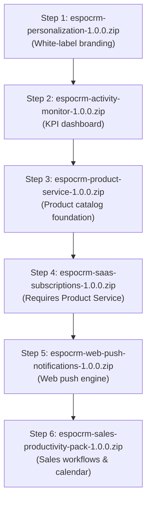

# CGIT EspoCRM Enterprise Extension Suite

[](https://www.espocrm.com/)
[](https://github.com/MIHMahmudEli/cgit-espocrm-extensions/releases)
[](file:///C:/xampp_lite_8_5/www/espocrm/packages/dist/README.md)
[](file:///C:/xampp_lite_8_5/www/espocrm/packages/dist/README.md)

Welcome to the official distribution repository for the **CGIT EspoCRM Enterprise Extension Suite**. This repository contains pre-compiled, cryptographically verified, ready-to-install `.zip` packages compatible with EspoCRM Administration Extension Manager.

---

## 📦 Available Extension Packages

This suite is available either as an **All-in-One Enterprise Bundle** or as **6 standalone modular extensions**:

| # | Package File | Size | Name | Key Purpose |
|:---:|:---|:---:|:---|:---|
| 👑 | **`espocrm-enterprise-custom-suite-1.0.0.zip`** | **278 KB** | **Enterprise Custom Suite (Bundle)** | **Recommended:** Installs all 6 extensions in a single package. |
| 1 | `espocrm-personalization-1.0.0.zip` | 34.7 KB | **Personalization & Branding** | Full white-labeling: logos, favicons, login view, navbar, notifications. |
| 2 | `espocrm-activity-monitor-1.0.0.zip` | 31.4 KB | **Activity Monitor** | Executive oversight dashboard, KPI counters, active users & diff tracking. |
| 3 | `espocrm-product-service-1.0.0.zip` | 86.6 KB | **Product & Service Catalogue** | Central product catalog, pricing rules, stream isolation & entity links. |
| 4 | `espocrm-saas-subscriptions-1.0.0.zip` | 100.2 KB | **SaaS Subscriptions & Plans** | Recurring subscription plans, billing cycles, change audit & snapshotting. |
| 5 | `espocrm-web-push-notifications-1.0.0.zip` | 83.6 KB | **Web Push & Desktop Alerts** | Real-time browser push notifications (VAPID) & meeting alert reminders. |
| 6 | `espocrm-sales-productivity-pack-1.0.0.zip` | 84.6 KB | **Sales Productivity Pack** | Auto-lookup, calendar week cards, auto-invites & meeting quick-fills. |

---

## 🔍 Detailed Extension Breakdown

### 👑 Enterprise Custom Suite (`espocrm-enterprise-custom-suite-1.0.0.zip`)
* **What it is:** The complete unified release containing the full code, backend services, metadata, client views, and migration hooks of all 6 individual extensions merged into one package.
* **Who it's for:** Anyone setting up or updating an EspoCRM instance that wants the full feature set without managing individual package uploads.

---

### 1. Personalization & White-Label Branding (`espocrm-personalization-1.0.0.zip`)
* **What it contains:**
  * **Brand Identity:** Replaces all default EspoCRM branding with custom CGIT corporate identity.
  * **Custom Assets:** High-resolution SVGs and PNGs in `client/custom/img/`:
    * `cgit-logo.png` & `cgit-logo-white.png` (navbar branding across both light and dark themes).
    * `cgit-favicon.png` (browser tab icons).
    * `cgit-crm-logo.png` (login view and desktop notification badges).
  * **Views & Controllers:**
    * Custom `views/site/navbar.js` with responsive branding dimensions.
    * Custom `views/login.js` branding container.
    * Custom notification badge provider using the company logo.
  * **System Configuration:** Pre-configures `applicationName: "CGIT CRM"` in system metadata.

---

### 2. Activity Monitor & KPI Dashboard (`espocrm-activity-monitor-1.0.0.zip`)
* **What it contains:**
  * **Entities & Controllers:** `ActivityMonitor` entity with dedicated API endpoints (`/api/v1/ActivityMonitor`).
  * **Executive Dashboard:** Real-time KPI summaries:
    * Total system entities & operations counters.
    * Today's active user roster with last-seen timestamps and relative time formatting.
    * Detailed audit stream tracking `create`, `update`, and `delete` events across all modules.
  * **Field Diff Inspector:** Visual badge indicators showing previous vs. updated field values.
  * **Access Control:** Integrated into EspoCRM role-based permissions (admin oversight view).

---

### 3. Product & Service Catalogue (`espocrm-product-service-1.0.0.zip`)
* **What it contains:**
  * **Core Entity:** `ProductService` entity supporting physical goods, digital products, consulting services, and software tiers.
  * **Fields & Attributes:** SKU, Unit Price, Cost, Currency, Active status, Tax rates, Category, and Stream tracking.
  * **Entity Integrations:** Automatic relationship fields linking Products to:
    * **Leads:** Associated product interest.
    * **Calls & Meetings:** Product discussed during sales engagements.
  * **Relationship Stream Isolation:** Prevents stream cross-contamination between products and related activities.

---

### 4. SaaS Subscriptions & Recurring Plans (`espocrm-saas-subscriptions-1.0.0.zip`)
> ⚠️ **Prerequisite:** Requires `espocrm-product-service-1.0.0.zip` to be installed first (or install the All-in-One Suite).
* **What it contains:**
  * **Entities:**
    * `SaaSSubscription`: Tracks customer subscriptions, status (`Active`, `Past Due`, `Canceled`), renewal dates, MRR, and pricing snapshots.
    * `SaaSPlan`: Defines subscription tiers (Monthly, Quarterly, Annual, Enterprise).
  * **Audit History:** `SaaSSubscriptionHistory` entity automatically records plan upgrades, downgrades, price adjustments, and cancellation reasons.
  * **Price Snapshotting:** Locks contracted pricing at subscription creation time to safeguard historical billing against future catalog price changes.

---

### 5. Web Push & Desktop Notifications (`espocrm-web-push-notifications-1.0.0.zip`)
* **What it contains:**
  * **Service Worker:** Native `public/sw.js` supporting standard browser Push API and Notification API.
  * **VAPID Security:** Backend cryptographic engine (`WebPushNotificationService`) handling elliptic curve VAPID key exchange.
  * **Subscription Management:** Endpoints for registering, refreshing, and revoking browser push tokens.
  * **Automated Cron Jobs:** Scheduled job checking upcoming `Meeting` and `Call` records, dispatching instant desktop alerts to assigned users 15 minutes before scheduled start time.

---

### 6. Sales Productivity Pack (`espocrm-sales-productivity-pack-1.0.0.zip`)
* **What it contains:**
  * **Lead Quick-Lookup:** Wildcard and exact matching on lead phone numbers, corporate email domains, and website URLs to prevent duplicate leads.
  * **Call & Meeting Auto-Fill:** Automatically presets start/end timestamps to the next upcoming top-of-the-hour slot when creating records.
  * **Auto-Attendee Invites:** Pre-populates meeting attendees with the contact/lead from the parent record.
  * **Calendar Week Card UI:** Enhanced calendar view displaying structured agenda cards with status tags, duration, and direct dial buttons.

---

## 🚦 Recommended Installation Order

If you are installing the **Enterprise Custom Suite Bundle**, install order does not matter because all dependencies are bundled together.

If you choose to install packages **individually**, you **MUST** follow this order to satisfy dependency requirements:



### Dependency Matrix

| Installation Step | Extension Package | Dependencies | Notes |
|:---:|:---|:---|:---|
| **Step 1** | `espocrm-personalization-1.0.0.zip` | *None* | Safe to install first; sets up branding and assets. |
| **Step 2** | `espocrm-activity-monitor-1.0.0.zip` | *None* | Adds oversight endpoints and dashboard layout. |
| **Step 3** | `espocrm-product-service-1.0.0.zip` | *None* | **Foundational.** Must be installed before SaaS Subscriptions. |
| **Step 4** | `espocrm-saas-subscriptions-1.0.0.zip` | **Product Service** | Links directly to `ProductService` entities. |
| **Step 5** | `espocrm-web-push-notifications-1.0.0.zip` | *None* | Requires PHP `curl` and `openssl`. |
| **Step 6** | `espocrm-sales-productivity-pack-1.0.0.zip` | *None* | Enhances Leads, Calls, and Meetings. |

---

## 💻 Installation Walkthrough

### Method 1: Via EspoCRM Web Administration UI (Recommended)

1. Log in to your EspoCRM instance as an **Administrator**.
2. Click the top-right hamburger menu (`≡`) or gear icon and select **Administration**.
3. Under the *Customization* section, select **Extensions** (or navigate directly to `/#Admin/extensions`).
4. Click **Choose File** (or *Browse*) and select your desired `.zip` package:
   * To install everything: choose `espocrm-enterprise-custom-suite-1.0.0.zip`.
   * Or choose individual packages in the [Recommended Installation Order](#-recommended-installation-order).
5. Click **Install**.
6. The installer will copy files, register metadata, execute schema updates, and rebuild backend caches.
7. Perform a hard refresh on your browser (`Ctrl + F5` or `Cmd + Shift + R`) to load the updated frontend scripts.

---

### Method 2: Via EspoCRM CLI (Terminal)

For automated server deployments, SSH environments, or Docker containers:

```bash
# Navigate to your EspoCRM root directory
cd /var/www/html/espocrm

# Option A: Install the All-In-One Enterprise Master Bundle
php command.php extension --file="/path/to/espocrm-enterprise-custom-suite-1.0.0.zip"

# Option B: Install individual extensions in order
php command.php extension --file="/path/to/espocrm-personalization-1.0.0.zip"
php command.php extension --file="/path/to/espocrm-activity-monitor-1.0.0.zip"
php command.php extension --file="/path/to/espocrm-product-service-1.0.0.zip"
php command.php extension --file="/path/to/espocrm-saas-subscriptions-1.0.0.zip"
php command.php extension --file="/path/to/espocrm-web-push-notifications-1.0.0.zip"
php command.php extension --file="/path/to/espocrm-sales-productivity-pack-1.0.0.zip"

# Rebuild cache and apply schema updates
php command.php rebuild

# Verify installed extensions
php command.php extension --list
```

---

## ⚙️ Post-Installation Setup & Configuration

### 1. Web Push Notifications Configuration
1. In EspoCRM, go to **Administration > Settings** (or user preferences).
2. Click **Enable Desktop Push Notifications**.
3. When prompted by your web browser, click **Allow**.
4. Ensure your server cron job is running every minute to process meeting alerts:
   ```crontab
   * * * * * php /var/www/html/espocrm/cron.php > /dev/null 2>&1
   ```

### 2. Navigation Bar Tabs
If newly added entities (`Product Service`, `SaaS Subscriptions`, `Activity Monitor`) do not appear in the top navbar:
1. Navigate to **Administration > User Interface**.
2. Drag the new entities from the **Available Tabs** column to the **Visible Tabs** column.
3. Click **Save**.

---

## 🔐 Package Cryptographic Integrity (SHA-256)

Always verify the integrity of your downloaded `.zip` packages before deploying to production environments:

```text
e4d06b880120db3e7e37c8cf03e68bd21c110edce0a698e2cf1d1b6e73fbad66  espocrm-activity-monitor-1.0.0.zip
3e277ec11dbd21f4fff3b27513d8c6d3444f985a3d7fcd6680a9fc08dbf8c605  espocrm-product-service-1.0.0.zip
cd1c1a6325f974baf573195ded3644b23c8bb7b8244dd8f204200c0806240495  espocrm-saas-subscriptions-1.0.0.zip
9a4c5f80f60560dd6ff822fa0088b57c524f37b3d49a1df772318fc7227d00fd  espocrm-web-push-notifications-1.0.0.zip
b2201c0fd95c467cebad3cf44a84e2ce194c3dd1c302cb7488fc67832df5a80e  espocrm-sales-productivity-pack-1.0.0.zip
05add2596893d38ea1226e1091e5b2aa6e2dc98dd39e1f62b5ed77cf74265409  espocrm-personalization-1.0.0.zip
308d6fd6217b557c5025bbd2033d284ff55941ebb4abf223078f218c6f65c8bb  espocrm-enterprise-custom-suite-1.0.0.zip
```

### Verification Commands:
* **Linux / macOS:**
  ```bash
  sha256sum -c checksums.sha256
  ```
* **Windows (PowerShell):**
  ```powershell
  Get-FileHash -Algorithm SHA256 *.zip
  ```

---

## 🔄 Uninstallation

To remove any extension cleanly:

* **Via Web UI:** Go to **Administration > Extensions**, find the extension row, click the dropdown menu (`v`), and click **Uninstall**.
* **Via CLI:**
  ```bash
  php command.php extension -u --name="Product Service Catalogue"
  php command.php rebuild
  ```

---

## 🛠️ Troubleshooting

| Issue | Cause | Resolution |
|---|---|---|
| **Upload fails with "File size exceeds limit"** | PHP `upload_max_filesize` is lower than package size. | Increase `upload_max_filesize = 10M` and `post_max_size = 10M` in `php.ini`. |
| **"Permission denied" during installation** | Web server does not have write access to `custom/` or `client/custom/`. | Run `chown -R www-data:www-data data/ custom/ client/` (or your web server user). |
| **Old branding or logo persists** | Browser cached previous static assets. | Press `Ctrl + Shift + R` (`Cmd + Shift + R` on Mac) to bypass cache. |
| **SaaS Subscriptions shows entity error** | Missing `ProductService` dependency. | Install `espocrm-product-service-1.0.0.zip` first, then run `php command.php rebuild`. |

---

## 📄 License & Maintainer

Maintained by **CGIT Engineering Team**.  
For enterprise support or feature inquiries, visit [CGIT GitHub Organization](https://github.com/MIHMahmudEli).
